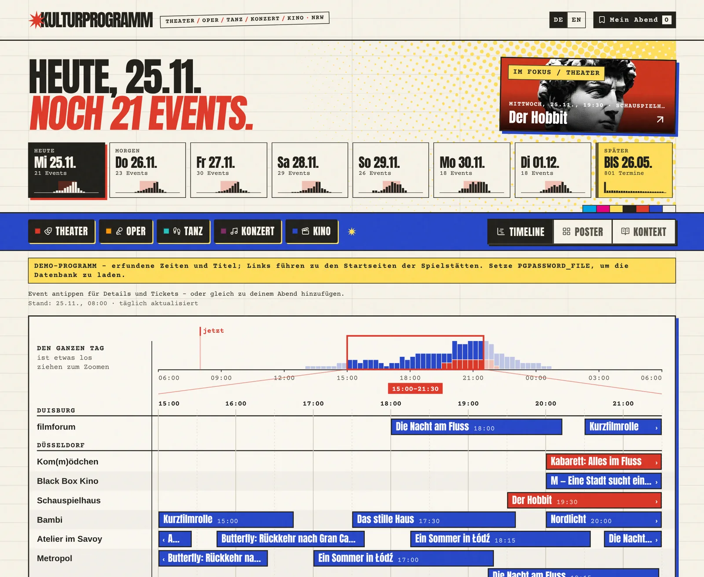

<p align="center">
  <picture>
    <source media="(prefers-color-scheme: dark)" srcset="docs/logo-dark.png">
    
  </picture>
</p>

<p align="center">Theatre, opera, dance, concerts and films in NRW on one timeline.<br>
<a href="https://kulturprogramm.eu">kulturprogramm.eu</a></p>



## How it works

A Python scraper reads the venues' programme pages into PostgreSQL once a day. An enricher writes a
short context note for each production with an AI model. A Next.js frontend shows the programme.
[`AGENTS.md`](AGENTS.md) is the full technical reference.

## Run it

```bash
cd frontend && pnpm install && pnpm dev    # http://localhost:3000, demo programme without a database
```

For the full stack with Docker Compose, see [`backend/deploy/`](backend/deploy/compose.yaml) and
"Common operations" in [`AGENTS.md`](AGENTS.md).

## Contribute

A venue is missing, or a scraper reads a page wrong? Open an issue or a pull request. Each website is
one `Source` class per website in [`backend/scraper/sources/`](backend/scraper/sources/); the rules are in [`docs/scrapers.md`](docs/scrapers.md).

## License

[AGPL-3.0-or-later](LICENSE). Programme data and images belong to the venues. Fonts: SIL Open Font
License (`frontend/public/fonts/`).
